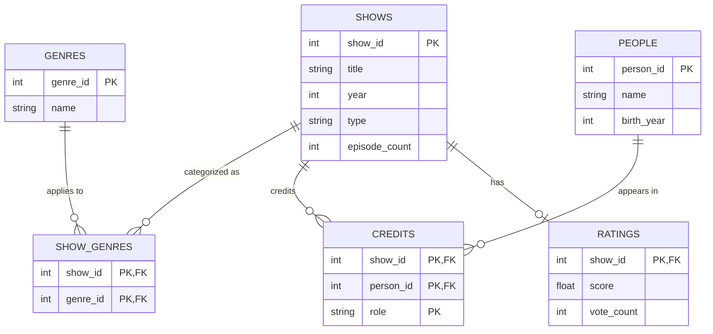

# Your Turn · A TV Show Catalog — Database Design

## ERD

## How this maps to the two pages

- **Show page** (`The Office`): a `SHOWS` row joined to `SHOW_GENRES` -> `GENRES` (for "Comedy"), to `CREDITS` -> `PEOPLE` filtered by `role = 'actor'` (for Stars) and `role = 'writer'` (for Writers), and an optional `RATINGS` row (for "9.0 from 739990 votes").
- **Person page** (`Steve Carell`): a `PEOPLE` row joined back through `CREDITS` -> `SHOWS` to list everything they appear in, regardless of role.

## Why it changed from the paper draft

- **`genre` moved out of `SHOWS` into its own `GENRES` + `SHOW_GENRES` tables.** A single string column can't hold "a show can have several genres" without repeating rows or stuffing multiple values into one field.
- **One `PEOPLE` table instead of a table with both `writer_id` and `actor_id` as keys.** A person is a person - their relation to a show (actor vs. writer) is a fact about the *relationship*, not about the person, and the same person could plausibly do both (e.g., write one show, act in another, or both on the same show).
- **Added `CREDITS` as a junction table with a `role` column** to represent the many-to-many relationship between `PEOPLE` and `SHOWS` for both "stars in" and "writes for," instead of one ambiguous "writes in/performs in" line.
- **`RATINGS` kept as its own table with a zero-or-one relationship to `SHOWS`** (`||--o|`), so a show with no rating yet simply has no matching row, instead of needing a nullable placeholder.

## Assumptions (things the two pages don't show)

- A show has exactly one title and one release year, but can have multiple genres.
- `type` on `SHOWS` (e.g., "TV series") is a single value per show, not a list.
- A rating is one aggregate score + vote count per show (not per-episode, not per-source like separate critic/audience scores).
- A person's `birth_year` is known/optional - the schema doesn't require it, since the person page only shows it when available.
- The "Stars" list on the show page and the "Stars in" list on the person page are two views of the same `CREDITS` rows where `role = 'actor'`; "Writers" uses `role = 'writer'`.
- A person can hold more than one role on the same show (e.g., write *and* act), which is why `role` is part of the `CREDITS` primary key rather than a single-valued attribute on the person or the credit row.
- Episode count is tracked at the show level only (no separate `EPISODES` table), since the pages only ever show a total count, not per-episode detail.
