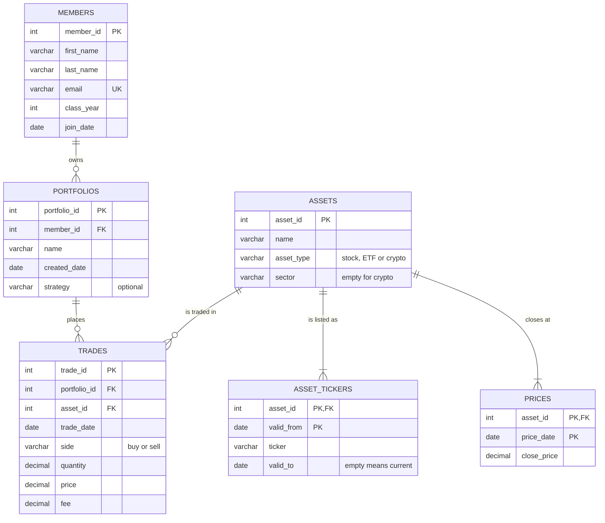

# Babson Investment Club Database

## 1. The Scenario

Scenario B, the Babson Investment Club. The club runs paper portfolios for its
members and keeps its records in a shared spreadsheet and broker screenshots.
It wants a clear history of every trade, and to see what each portfolio holds
and what it is worth.

## 2. The ERD

## 3. What One Row Means

- One row of `members` is one Babson student who joined the investment club.
- One row of `portfolios` is one paper portfolio owned by one member.
- One row of `assets` is one investment that the club follows, such as a stock, an ETF or a crypto.
- One row of `asset_tickers` is one ticker that one asset used during one stretch of time.
- One row of `prices` is the closing price of one asset on one day.
- One row of `trades` is one buy or sell of one asset by one portfolio on one day.

## 4. Design Choices

**1. Keys where the business already had one.** Members already had a school email, but I used `member_id` as the key and made email UNIQUE so no two members share one. Assets already had tickers, but a ticker can change (Block went from SQ to XYZ), so I used `asset_id` as the key and gave tickers their own table.

**2. Optional relationships.** A member may own no portfolio (members 14 and 15), a portfolio may have no trades yet, and an asset may never be traded (the Vanguard Total Bond ETF). A trade always belongs to exactly one portfolio and one asset.

**3. Rules my tables cannot hold.** "A portfolio never sells more than it holds" needs to add up earlier trades, which a CHECK cannot do, so I check it with a query in question 8. "A trade happens on a day its asset has a closing price" is also checked with a query, in question 7, so that the two broken rows for that question can load.

**4. An agent proposal I changed.** My agent first charted Bitcoin in "A Look at the Data". I changed it to NVIDIA because I wanted to look at an AI tech company.

Note: sections 1–3 were committed in `be252ee` ("What one row of each table means (completed)"), before `build.py` was added. That is my "db: add the question and the plan" commit.