# Babson Investment Club Database

## 1. The scenario

Scenario B, the Babson Investment Club. The club runs paper portfolios for its
members and keeps its records in a shared spreadsheet and broker screenshots.
It wants a clear history of every trade, and to see what each portfolio holds
and what it is worth.

## 2. The ERD

```mermaid
erDiagram
    MEMBERS ||--o{ PORTFOLIOS : owns
    PORTFOLIOS ||--o{ TRADES : places
    ASSETS ||--o{ TRADES : "is traded in"
    ASSETS ||--|{ ASSET_TICKERS : "is listed as"
    ASSETS ||--|{ PRICES : "closes at"
    PRICES ||--o{ TRADES : "prices"

    MEMBERS {
        int member_id PK
        varchar first_name
        varchar last_name
        varchar email UK
        int class_year
        date join_date
    }
    PORTFOLIOS {
        int portfolio_id PK
        int member_id FK
        varchar name
        date created_date
        varchar strategy "optional"
    }
    ASSETS {
        int asset_id PK
        varchar name
        varchar asset_type "stock, ETF or crypto"
        varchar sector "empty for crypto"
    }
    ASSET_TICKERS {
        int asset_id PK, FK
        date valid_from PK
        varchar ticker
        date valid_to "empty means current"
    }
    PRICES {
        int asset_id PK, FK
        date price_date PK
        decimal close_price
    }
    TRADES {
        int trade_id PK
        int portfolio_id FK
        int asset_id FK
        date trade_date FK
        varchar side "buy or sell"
        decimal quantity
        decimal price
        decimal fee
    }
```

## 3. What one row of each table means

- One row of `members` is one Babson student who joined the investment club.
- One row of `portfolios` is one paper portfolio owned by one member.
- One row of `assets` is one investment that the club follows, such as a stock, an ETF or a crypto.
- One row of `asset_tickers` is ...
- One row of `prices` is ...
- One row of `trades` is ...

## 4. Design choices